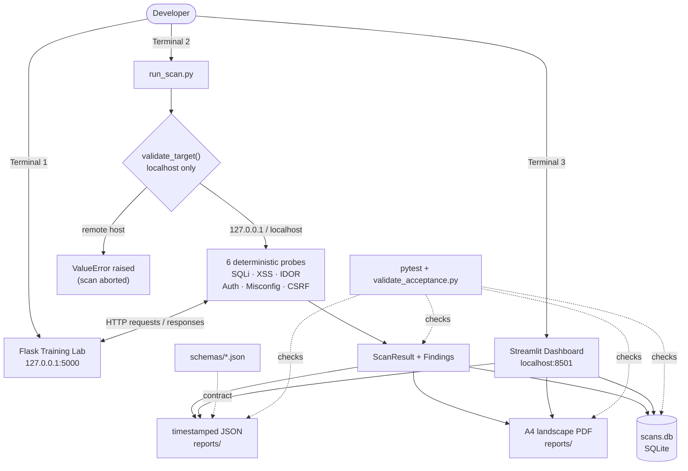

# VulnAudit


> **A local VAPT platform** — deliberate vulnerabilities, deterministic probes, JSON/PDF reports, and a Streamlit history dashboard. Everything runs on `127.0.0.1`.

---

> [!WARNING]
> **This is a controlled educational environment.** The Flask lab is intentionally vulnerable and must run only on `localhost`. Do not bind it to `0.0.0.0` or expose port `5000` through any tunnel or proxy. Do not use the scanner against any system you do not own or lack explicit written authorization to test. See [`DISCLAIMER.md`](DISCLAIMER.md).

---

## Table of Contents

- [How it works](#how-it-works)
- [Architecture](#architecture)
- [Quick start](#quick-start)
- [Installation](#installation)
- [The training lab](#the-training-lab)
- [Detection model](#detection-model)
  - [VA-001 — SQL injection](#va-001--sql-injection)
  - [VA-002 — Reflected XSS](#va-002--reflected-xss)
  - [VA-003 — IDOR](#va-003--idor)
  - [VA-004 — Weak authentication](#va-004--weak-authentication)
  - [VA-005 — Security misconfiguration](#va-005--security-misconfiguration)
  - [VA-006 — CSRF](#va-006--csrf)
- [Report outputs](#report-outputs)
- [Streamlit dashboard](#streamlit-dashboard)
- [SQLite schema](#sqlite-schema)
- [Configuration](#configuration)
- [Testing and verification](#testing-and-verification)
- [Repository map](#repository-map)
- [Troubleshooting](#troubleshooting)

---

## How it works

VulnAudit has three moving parts, each with a single responsibility:

| Part | What it does |
|------|-------------|
| **Flask lab** (`lab/app.py`) | Provides six routes, each exhibiting a specific, reproducible vulnerability. Restarting resets all synthetic data. |
| **Scanner** (`scanner/`) | Validates the target is localhost, runs six deterministic probe stages over HTTP, and writes the results. |
| **Dashboard** (`scanner/dashboard.py`) | Reads SQLite history, triggers new scans with a live progress stream, and serves JSON/PDF downloads. |

The scanner is **not** a crawler. Each probe sends a specific request pattern and emits a finding only when a specific condition is met — no heuristic scoring.

---

## Architecture



---

## Quick start

Three terminals, three commands — the complete local workflow:

```bash
# Terminal 1 — start the lab (resets synthetic data on each run)
python run_lab.py
```

```bash
# Terminal 2 — run a full scan and generate JSON + PDF reports
python run_scan.py http://127.0.0.1:5000
```

```bash
# Terminal 3 — launch the history dashboard
python run_dashboard.py
```

**Expected scan output** (from `scan-output.txt` in this repository):

```
Scan completed in 346 ms; findings=10
VA-002  High    Reflected cross-site scripting
VA-003  Medium  Insecure direct object reference
VA-004  High    Weak authentication controls
VA-005-x-content-type-options   Medium  Missing x-content-type-options
VA-005-x-frame-options          Medium  Missing x-frame-options
VA-005-content-security-policy  Medium  Missing content-security-policy
VA-005-strict-transport-security Medium  Missing strict-transport-security
VA-005-debug    Medium  Verbose error disclosure
VA-005-static   Low     Directory listing enabled
VA-006  High    Cross-site request forgery protection absent
```

> **Note:** `VA-001` (SQL injection) is defined in the scanner and may appear in your runs. The committed `scan-output.txt` records a 10-finding run; `VERIFICATION.md` documents a separate session that produced 11 findings including `VA-001`. Both represent real scanner behaviour from different lab states.

Reports land in `reports/` as a timestamped pair:

```
reports/
├── vulnaudit-20261007T155008Z.json
└── vulnaudit-20261007T155008Z.pdf
```

---

## Installation

**Python 3.10 or later is required.** Run all commands from the repository root; the project is not packaged as an installable distribution.

### Dependencies

| Package | Pinned version | Role |
|---------|---------------|------|
| `Flask` | `3.1.2` | Training lab server |
| `requests` | `2.32.5` | Scanner HTTP client |
| `beautifulsoup4` | `4.14.2` | XSS probe response parsing |
| `fpdf2` | `2.8.4` | A4 landscape PDF generation |
| `streamlit` | `1.50.0` | Dashboard UI |
| `pytest` | `8.4.2` | Test runner |

### Windows (PowerShell)

```powershell
python -m venv .venv
.\.venv\Scripts\Activate.ps1
python -m pip install -r requirements.txt
```

If script execution is blocked in your PowerShell session, use the environment directly:

```powershell
.\.venv\Scripts\python.exe -m pip install -r requirements.txt
.\.venv\Scripts\python.exe run_lab.py
```

### macOS / Linux

```bash
python3 -m venv .venv
source .venv/bin/activate
python -m pip install -r requirements.txt
```

---

## The training lab

The lab starts on `http://127.0.0.1:5000` and seals itself to that address. `run_lab.py` calls `init_db()` before Flask starts, which recreates all synthetic data — **restarting the lab resets everything**.

**Seeded data:**
- 10 users with IDs `1` – `10`
- Each user has a synthetic account starting at a balance of `1000`

The lab uses its own database at `lab/lab.db`, separate from the scanner's history database at `scans.db`.

### Routes

| Route | Method | Vulnerability |
|-------|--------|--------------|
| `/login` | `POST` | SQL injection; weak credential acceptance |
| `/search` | `GET` | Reflected XSS (no output encoding) |
| `/user/<id>` | `GET` | IDOR — no ownership check on object retrieval |
| `/admin/debug` | `GET` | Verbose traceback; missing four security headers |
| `/static/` | `GET` | Directory listing enabled |
| `/transfer` | `POST` | State-changing request with no CSRF token |

> `/transfer` **mutates state** — it subtracts the submitted amount from a synthetic account balance and persists the result. Restarting the lab restores the seeded `1000` balance.

---

## Detection model

All six probe stages run in order through `run_probe_stream()` in `scanner/probes.py`. The CLI and dashboard both consume the same generator; the dashboard renders each completed probe incrementally.

### Probe summary

| ID | Severity | OWASP | Endpoint | Detection condition |
|----|----------|-------|----------|-------------------|
| `VA-001` | 🔴 Critical | A03 Injection | `POST /login` | SQL error marker + boolean-true/false authentication divergence |
| `VA-002` | 🟠 High | A03 Injection | `GET /search` | `VULNAUDIT_XSS_7F3A` marker reflected **and** script element parsed by BeautifulSoup |
| `VA-003` | 🟡 Medium | A01 Broken Access | `GET /user/<id>` | ≥ 3 distinct successful response bodies across IDs `1`–`20` |
| `VA-004` | 🟠 High | A07 Auth Failures | `POST /login` | Weak token entropy **or** common credentials accepted without lockout |
| `VA-005-*` | 🟡 Medium / 🔵 Low | A05 Security Misconfig | `/admin/debug`, `/static/` | See table below |
| `VA-006` | 🟠 High | A01 Broken Access | `POST /transfer` | Balance-changing transfer succeeds without a CSRF token |

All HTTP requests use a **5-second timeout** (hard-coded in probe functions).

---

### VA-001 — SQL injection

**Endpoint:** `POST /login`

The probe submits three payloads in sequence: a bare single quote (error detection), a boolean-true string, and a boolean-false string. It checks the authentication state, HTTP status, and response length across those three responses. The finding is emitted when both the SQL-error condition and the boolean-based divergence are satisfied simultaneously.

---

### VA-002 — Reflected XSS

**Endpoint:** `GET /search`

The scanner embeds the marker `VULNAUDIT_XSS_7F3A` inside a script payload, sends it as the search term, then parses the response with BeautifulSoup. A finding is emitted only when the marker is reflected **and** the expected script element is present in the parsed DOM — raw text reflection alone does not trigger it.

---

### VA-003 — IDOR

**Endpoint:** `GET /user/<id>`

The probe requests IDs `1` through `20` and records distinct response bodies. The finding is emitted when at least three distinct, successful responses are returned — confirming that user records are accessible without an ownership check. The severity is **Medium** (a PRD inconsistency noting a previous High mapping is recorded in `VERIFICATION.md`; the scanner uses Medium).

---

### VA-004 — Weak authentication

**Endpoint:** `POST /login`

The probe attempts `admin` / `admin`, reads the returned session token when one is available, estimates its entropy, and then makes five deliberate failed attempts to observe lockout behaviour. A finding is emitted for low-entropy token material **or** for successful common-credential login without triggering lockout.

---

### VA-005 — Security misconfiguration

Six independent findings, all from two endpoints:

| Finding ID | Endpoint | Check | Severity |
|-----------|----------|-------|----------|
| `VA-005-x-content-type-options` | `/admin/debug` | `X-Content-Type-Options` absent | 🟡 Medium |
| `VA-005-x-frame-options` | `/admin/debug` | `X-Frame-Options` absent | 🟡 Medium |
| `VA-005-content-security-policy` | `/admin/debug` | `Content-Security-Policy` absent | 🟡 Medium |
| `VA-005-strict-transport-security` | `/admin/debug` | `Strict-Transport-Security` absent | 🟡 Medium |
| `VA-005-debug` | `/admin/debug` | Traceback returned in response body | 🟡 Medium |
| `VA-005-static` | `/static/` | Directory listing present | 🔵 Low |

---

### VA-006 — CSRF

**Endpoint:** `POST /transfer`

The scanner submits a balance-changing transfer request with no CSRF token. The finding is emitted when the transfer succeeds — confirming the server performs no token validation on state-changing requests.

---

## Report outputs

Every completed scan writes a timestamped pair to `reports/` (configurable via `--report-dir`):

```
reports/
├── vulnaudit-20261007T155008Z.json
└── vulnaudit-20261007T155008Z.pdf
```

### JSON

Top-level structure:

```json
{
  "target_url": "http://127.0.0.1:5000",
  "scanner_version": "1.0.0",
  "duration_ms": 346,
  "generated_at": "2026-10-07T15:50:08+00:00",
  "findings": []
}
```

Each finding:

```json
{
  "id": "VA-002",
  "title": "Reflected cross-site scripting",
  "owasp_category": "A03 Injection",
  "severity": "High",
  "description": "...",
  "evidence": {
    "request": "...",
    "response_snippet": "..."
  },
  "remediation": "..."
}
```

`response_snippet` is capped at **2048 characters** by `scanner.probes._safe_text()`, matching the constraint in `schemas/scan-result.schema.json`.

**Valid severity values:** `Critical` · `High` · `Medium` · `Low` · `Informational`

JSON contracts are defined in:
- `schemas/finding.schema.json`
- `schemas/scan-result.schema.json`

### PDF

`scanner/report.py` generates an **A4 landscape** PDF using `fpdf2`. Section order:

1. Cover
2. Executive Summary
3. Scope
4. Methodology
5. Finding Summary
6. Detailed Findings
7. Appendix

The PDF is generated from the same `ScanResult` object as the JSON — no additional probes are run.

---

## Streamlit dashboard

### Launch

```bash
# Recommended
python run_dashboard.py

# Also valid
streamlit run scanner/dashboard.py
streamlit run dashboard_app.py
```

Opens at **`http://localhost:8501`**.

### Sidebar controls

| Control | Description |
|---------|-------------|
| Base URL | Defaults to `http://127.0.0.1:5000`; validated against the same localhost-only rule as the CLI |
| **Run scan** | Triggers a full probe stream with live per-probe progress |
| Page selector | Overview · Findings · History |
| Scanner version | Displayed as `1.0.0` |
| Target status | Confirms local target |

### Overview page

Displays the most recent completed scan:
- Total finding count
- Counts by severity (Critical / High / Medium / Low)
- Top-priority findings by severity
- Download buttons for the JSON and PDF reports

### Findings page

Severity filter: `All` · `Critical` · `High` · `Medium` · `Low` · `Informational`

Each finding is an expandable row showing description, evidence payload, and remediation guidance.

### History page

Lists the 20 most recent scans from `scans.db`:

| Column | Content |
|--------|---------|
| Scan ID | SQLite autoincrement ID |
| Timestamp | ISO timestamp |
| Target URL | Scanned host |
| Duration | Milliseconds |

**Finding deltas** (when two or more scans exist): the dashboard compares the two most recent scans by finding **title** and classifies each as `New`, `Fixed`, or `Unchanged`. Deltas appear below the scan history table. A severity or evidence change under an unchanged title is not separately classified.

---

## SQLite schema

History is stored in `scans.db`. `scanner/database.py` creates two tables on first use.

### `scans`

| Column | Type |
|--------|------|
| `id` | `INTEGER PRIMARY KEY AUTOINCREMENT` |
| `timestamp` | `TEXT` |
| `target_url` | `TEXT` |
| `duration_ms` | `INTEGER` |

### `findings`

| Column | Type |
|--------|------|
| `id` | `INTEGER PRIMARY KEY AUTOINCREMENT` |
| `scan_id` | `INTEGER` (foreign key → `scans.id`) |
| `title` | `TEXT` |
| `severity` | `TEXT` |
| `owasp_category` | `TEXT` |
| `evidence` | `TEXT` (JSON-encoded) |
| `remediation` | `TEXT` |

---

## Configuration

VulnAudit has no YAML or TOML config file. All settings come from CLI flags or hard-coded defaults.

| Setting | Source | Default |
|---------|--------|---------|
| Scan target | CLI argument / dashboard input | `http://127.0.0.1:5000` |
| History database | `--db` flag | `scans.db` |
| Report directory | `--report-dir` flag | `reports/` |
| HTTP timeout | Hard-coded in probe functions | `5` seconds |
| Scanner version | `scanner.probes.VERSION` | `1.0.0` |

### CLI flags

```bash
python run_scan.py <base_url> [--db PATH] [--report-dir PATH]
```

Examples:

```bash
python run_scan.py http://127.0.0.1:5000 --db custom.db
python run_scan.py http://127.0.0.1:5000 --report-dir ./output
```

---

## Testing and verification

### Run the test suite

```bash
python -m pytest -q
```

`tests/test_project.py` covers:
- localhost-only target validation
- local binding enforcement
- detection across all six vulnerability classes
- repeatability — identical finding sets across two consecutive scans

`test_sqli.py` at the root is a focused SQL-injection test module.

### Acceptance validator

The validator checks JSON schema compliance, PDF structure, SQLite persistence, and PRD-level acceptance criteria.

```bash
# Basic run against the most recent reports
python validate_acceptance.py

# Specify artifacts explicitly
python validate_acceptance.py \
  --json reports/vulnaudit-YYYYMMDDTHHMMSSZ.json \
  --pdf  reports/vulnaudit-YYYYMMDDTHHMMSSZ.pdf \
  --db   scans.db

# Enforce the 2048-character evidence cap
python validate_acceptance.py --max-snippet 2048

# Skip SQLite checks (e.g. when running without a prior scan)
python validate_acceptance.py --skip-db
```

### Minimum check after a code change

```bash
python -m pytest -q
python validate_acceptance.py --max-snippet 2048
```

If `scanner/report.py` was changed, inspect the rendered PDF as well as the validator output.

### Recorded evidence

| File | Contents |
|------|----------|
| `VERIFICATION.md` | Build-session pass: route inventory, localhost binding, probe coverage, severity values, PDF section order, JSON schema, SQLite persistence, repeatability, target validation |
| `FRONTEND_VERIFICATION.md` | Streamlit-specific verification: History table, dashboard interaction |
| `scan-output.txt` | Committed CLI output from a real scan run (10 findings, 346 ms) |

---

## Repository map

<details>
<summary>Full file list with responsibilities</summary>

| Path | Responsibility |
|------|---------------|
| `run_lab.py` | Starts the Flask training lab (`init_db()` + Flask run) |
| `run_scan.py` | CLI entry point — validates target, orchestrates scan, writes outputs |
| `run_dashboard.py` | Convenience Streamlit launcher |
| `dashboard_app.py` | Thin entry point that calls `scanner.dashboard.main()` |
| `lab/app.py` | Six vulnerable routes, synthetic data seeding, `lab.db` initialization |
| `scanner/probes.py` | All six probe implementations + `run_probe_stream()` + `VERSION` |
| `scanner/models.py` | `Finding` and `ScanResult` dataclasses; allowed severity values |
| `scanner/cli.py` | `validate_target()`, scan orchestration, report dispatch, SQLite writes |
| `scanner/database.py` | SQLite connection helper, `scans` and `findings` table creation |
| `scanner/report.py` | JSON serialization + A4 landscape PDF rendering |
| `scanner/dashboard.py` | Streamlit UI — live scan progress, Overview / Findings / History pages |
| `schemas/finding.schema.json` | JSON Schema for a single `Finding` object |
| `schemas/scan-result.schema.json` | JSON Schema for a complete `ScanResult` |
| `tests/test_project.py` | Project-level pytest suite |
| `test_sqli.py` | Focused SQL-injection test module (root level) |
| `validate_acceptance.py` | PRD acceptance checks — JSON, PDF, SQLite, evidence cap |
| `scan-output.txt` | Committed CLI output from a real scan run |
| `VERIFICATION.md` | Build-session verification record |
| `DISCLAIMER.md` | Responsible-use statement |
| `requirements.txt` | Six pinned dependencies |

</details>

---

## Troubleshooting

<details>
<summary><code>ValueError: VulnAudit only permits localhost targets</code></summary>

The scanner enforces localhost-only targets before any probe runs. Use `http://127.0.0.1:5000` or `http://localhost:5000`. Remote targets are rejected by design, not by configuration.

</details>

<details>
<summary><code>ConnectionRefusedError</code> on port 5000</summary>

The lab is not running. Start it first in a separate terminal:

```bash
python run_lab.py
```

Then run the scan or dashboard in a second terminal.

</details>

<details>
<summary><code>ModuleNotFoundError: No module named 'scanner'</code> or <code>'lab'</code></summary>

The project is not an installable package. Run all commands from the repository root directory:

```bash
cd /path/to/VulnAudit
python run_scan.py http://127.0.0.1:5000
```

</details>

<details>
<summary>PowerShell blocks <code>Activate.ps1</code> (execution policy error)</summary>

Use the venv's Python binary directly — no activation required:

```powershell
.\.venv\Scripts\python.exe -m pip install -r requirements.txt
.\.venv\Scripts\python.exe run_lab.py
.\.venv\Scripts\python.exe run_scan.py http://127.0.0.1:5000
.\.venv\Scripts\python.exe run_dashboard.py
```

</details>

<details>
<summary>Account balances are different after a test run</summary>

Expected behaviour. `POST /transfer` mutates the synthetic account balance in `lab/lab.db`. Restart the lab to restore all balances to `1000`:

```bash
# Ctrl+C the running lab, then:
python run_lab.py
```

</details>

<details>
<summary>Dashboard shows no history</summary>

History requires at least one completed CLI or dashboard scan. `scans.db` is created on first use. Run:

```bash
python run_scan.py http://127.0.0.1:5000
```

then reload the dashboard History page.

</details>

---

## Responsible use

> This repository is a controlled educational environment for learning offensive security concepts from a defensive perspective. The vulnerable application is intended to run only on localhost. Do not expose it to any network. Do not use the scanner against systems you do not own or lack explicit written permission to test. The authors accept no liability for misuse.
>
> — [`DISCLAIMER.md`](DISCLAIMER.md)

**Do not:**
- Bind the lab to `0.0.0.0` or any interface other than `127.0.0.1`
- Expose port `5000` through an SSH tunnel, `ngrok`, or a reverse proxy
- Scan any system without ownership or explicit written authorization
- Treat the synthetic findings as evidence about any real third-party system
