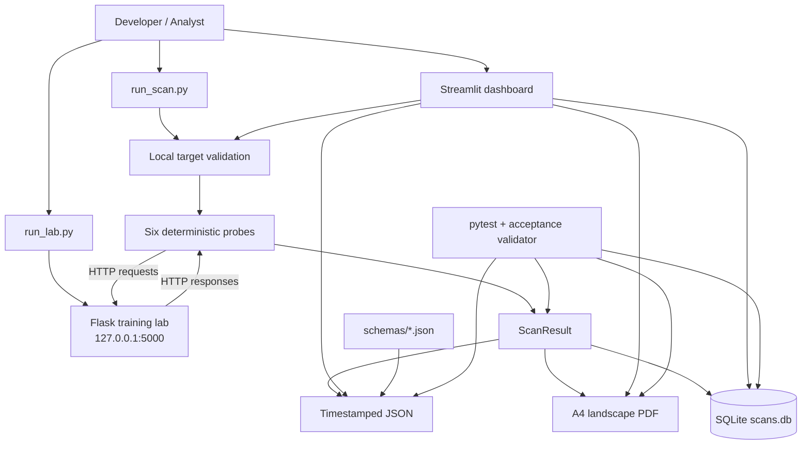

# VulnAudit

> **Controlled educational / defensive security research only.** VulnAudit is designed to run against its local training lab on `127.0.0.1:5000`. Do not expose the lab to a network or scan systems you do not own or have explicit permission to test.

VulnAudit is a local vulnerability-assessment project built around one controlled target and one scan result that is presented three ways:

- a deliberately vulnerable **Flask lab** provides repeatable behaviors,
- a deterministic **Python scanner** probes those behaviors,
- **JSON** and an **A4 landscape PDF** record the result, and
- **SQLite + Streamlit** preserve and present scan history.

The project is intentionally small: the lab is the target, `scanner/probes.py` contains the detection rules, `scanner/cli.py` orchestrates scans, `scanner/report.py` creates reports, and `scanner/dashboard.py` provides the user interface.

---

## 1. How the project fits together

A typical run looks like this:

```text
1. Start the Flask lab
        |
        v
2. Use the CLI or dashboard
        |
        v
3. Validate that the target is local
        |
        v
4. Run six deterministic probe stages
        |
        v
5. Build ScanResult + Finding objects
        |
        +------------+-------------+
        |            |             |
        v            v             v
      JSON          PDF         SQLite
        |            |             |
        +------------+-------------+
                     |
                     v
              Streamlit History
              + finding deltas
```

The scanner is **not** a crawler. Each probe has a specific request pattern and a specific condition for emitting a finding. The dashboard uses the same probe stream as the CLI; it does not implement another scanner.

### Architecture



---

## 2. Repository map

| Path | Responsibility |
|---|---|
| `run_lab.py` | Starts the Flask training lab. |
| `run_scan.py` | CLI entry point for a full scan. |
| `run_dashboard.py` | Convenience Streamlit launcher. |
| `dashboard_app.py` | Thin Streamlit entry point that calls `scanner.dashboard.main()`. |
| `lab/app.py` | Vulnerable Flask routes, seeded data, and lab database initialization. |
| `scanner/probes.py` | SQLi, XSS, IDOR, authentication, security-misconfiguration, and CSRF probes. |
| `scanner/models.py` | `Finding`, `ScanResult`, and the allowed severity values. |
| `scanner/cli.py` | Target validation, scan orchestration, report generation, and history writes. |
| `scanner/database.py` | SQLite connection helper and schema creation. |
| `scanner/report.py` | JSON serialization and PDF rendering. |
| `scanner/dashboard.py` | Streamlit UI, live scan progress, findings, exports, history, and deltas. |
| `schemas/finding.schema.json` | JSON Schema for one finding. |
| `schemas/scan-result.schema.json` | JSON Schema for a complete scan result. |
| `tests/test_project.py` | Project-level tests. |
| `test_sqli.py` | Focused SQL-injection test module. |
| `validate_acceptance.py` | Validates JSON, PDF, SQLite, and related PRD checks. |
| `VERIFICATION.md` | Recorded build-session verification evidence. |
| `FRONTEND_VERIFICATION.md` | Recorded Streamlit/frontend verification evidence. |
| `LANDSCAPE_PDF_CHANGE.md` | Notes on the A4 landscape PDF change. |
| `DISCLAIMER.md` | Responsible-use rules. |
| `requirements.txt` | Pinned dependencies. |

The repository has no `pyproject.toml` or `setup.py`; run commands from the project root.

---

## 3. The local training lab

The lab is deliberately vulnerable and is intended to run only on:

```text
http://127.0.0.1:5000
```

`run_lab.py` calls `init_db()` before starting Flask. The initialization recreates the synthetic users and accounts, so restarting the lab resets the training data.

The lab seeds 10 users with IDs `1` through `10`; the synthetic accounts start at a balance of `1000`.

The lab stores its own data in:

```text
lab/lab.db
```

This is separate from the scanner's history database, `scans.db`.

### Routes

| Route | Method | Lab purpose |
|---|---|---|
| `/login` | `POST` | SQL injection and weak-authentication behavior. |
| `/search` | `GET` | Reflected HTML/script input. |
| `/user/<id>` | `GET` | Object retrieval without an ownership check. |
| `/admin/debug` | `GET` | Synthetic traceback and security-header checks. |
| `/static/` | `GET` | Directory-listing behavior. |
| `/transfer` | `POST` | State-changing request without CSRF protection. |

---

## 4. Detection model

`scanner/probes.py` defines six stages. They run in this order through `run_probe_stream()`:

1. SQL injection
2. Reflected XSS
3. IDOR
4. Authentication controls
5. Security headers / debug / directory listing
6. CSRF

A single stage can emit multiple findings, which is why six stages produce the 11-finding reference set.

### VA-001 — SQL injection in login

**Endpoint:** `POST /login`

The probe submits:

- a single quote to look for SQL error markers,
- a boolean-true payload, and
- a boolean-false payload.

It checks authentication state, status, and response length. The current implementation emits the finding when both the SQL-error and boolean-based conditions are satisfied.

### VA-002 — Reflected cross-site scripting

**Endpoint:** `GET /search`

The scanner adds the marker `VULNAUDIT_XSS_7F3A` to a script payload, parses the response with BeautifulSoup, and requires both marker reflection and the expected script element.

### VA-003 — Insecure direct object reference

**Endpoint:** `GET /user/<id>`

IDs `1` through `20` are requested. The scanner requires at least three distinct successful response bodies before emitting the finding.

The implementation reports this synthetic, non-sensitive IDOR as **Medium**. The repository's verification record documents a PRD inconsistency where another mapping table lists High; the fixed severity rule is the value used by the scanner.

### VA-004 — Weak authentication controls

**Endpoint:** `POST /login`

The probe:

- attempts `admin` / `admin`,
- reads the returned token when available,
- estimates token entropy, and
- makes five failed attempts.

A finding is emitted for weak token material or successful common credentials without the expected lockout behavior.

### VA-005 — Security misconfiguration

The probe checks the `/admin/debug` response for four headers and for a traceback, then checks `/static/` for a directory listing.

| Finding ID | Check | Severity |
|---|---|---|
| `VA-005-x-content-type-options` | Missing `X-Content-Type-Options` | Medium |
| `VA-005-x-frame-options` | Missing `X-Frame-Options` | Medium |
| `VA-005-content-security-policy` | Missing `Content-Security-Policy` | Medium |
| `VA-005-strict-transport-security` | Missing `Strict-Transport-Security` | Medium |
| `VA-005-debug` | Traceback returned by `/admin/debug` | Medium |
| `VA-005-static` | Directory listing at `/static/` | Low |

### VA-006 — CSRF protection absent

**Endpoint:** `POST /transfer`

The scanner submits a balance-changing request without a CSRF token and reports the finding when the transfer succeeds.

---

## 5. Reference findings and severities

The repository's verified JSON evidence contains this 11-finding reference set:

| ID | Severity | Title |
|---|---|---|
| `VA-001` | Critical | SQL injection in login |
| `VA-002` | High | Reflected cross-site scripting |
| `VA-003` | Medium | Insecure direct object reference |
| `VA-004` | High | Weak authentication controls |
| `VA-005-x-content-type-options` | Medium | Missing x-content-type-options |
| `VA-005-x-frame-options` | Medium | Missing x-frame-options |
| `VA-005-content-security-policy` | Medium | Missing content-security-policy |
| `VA-005-strict-transport-security` | Medium | Missing strict-transport-security |
| `VA-005-debug` | Medium | Verbose error disclosure |
| `VA-005-static` | Low | Directory listing enabled |
| `VA-006` | High | Cross-site request forgery protection absent |

Reference severity totals:

| Critical | High | Medium | Low | Informational |
|---:|---:|---:|---:|---:|
| 1 | 3 | 6 | 1 | 0 |

These counts describe the verified synthetic lab baseline; they are not a promise about an arbitrary target.

---

## 6. Scan data model

### `Finding`

`scanner.models.Finding` contains:

```text
id
title
owasp_category
severity
description
evidence
remediation
```

### `ScanResult`

`scanner.models.ScanResult` contains:

```text
target_url
scanner_version
duration_ms
findings
```

The scanner version is currently:

```text
1.0.0
```

Allowed severity values are exactly:

```text
Critical
High
Medium
Low
Informational
```

---

## 7. Target validation and locality

`scanner.cli.validate_target()` runs before any probe begins.

Accepted hostnames are:

```text
127.0.0.1
localhost
```

Accepted schemes are `http` and `https`.

For the supplied lab, use:

```text
http://127.0.0.1:5000
```

A remote target is rejected by default with a localhost-only validation error. This is a core safety boundary of the project, not a dashboard-only restriction.

---

## 8. Installation

### Requirements

The pinned dependencies are:

| Package | Version |
|---|---:|
| Flask | `3.1.2` |
| requests | `2.32.5` |
| beautifulsoup4 | `4.14.2` |
| fpdf2 | `2.8.4` |
| streamlit | `1.50.0` |
| pytest | `8.4.2` |

Python `3.10+` is required by the project documentation. The development environment used during the recorded build was Python `3.14.6`.

### Windows PowerShell

```powershell
python -m venv .venv
.\.venv\Scripts\Activate.ps1
python -m pip install -r requirements.txt
```

If activation is unavailable in the current PowerShell session, the environment can still be used directly:

```powershell
.\.venv\Scripts\python.exe -m pip install -r requirements.txt
```

### macOS / Linux

```bash
python3 -m venv .venv
source .venv/bin/activate
python -m pip install -r requirements.txt
```

---

## 9. Run a complete local scan

### Step 1 — start the lab

```bash
python run_lab.py
```

The lab starts on:

```text
http://127.0.0.1:5000
```

### Step 2 — scan from another terminal

```bash
python run_scan.py http://127.0.0.1:5000
```

`scanner.cli.scan()` performs this sequence:

```text
validate target
    -> run six probes
    -> create ScanResult
    -> write JSON
    -> write PDF
    -> save scan + findings to SQLite
```

The command prints the total duration and one line per finding.

### CLI options

```text
python run_scan.py <base_url> [--db PATH] [--report-dir PATH]
```

Examples:

```bash
python run_scan.py http://127.0.0.1:5000 --db scans.db
```

```bash
python run_scan.py http://127.0.0.1:5000 --report-dir reports
```

Defaults:

```text
--db scans.db
--report-dir reports
```

---

## 10. Run the Streamlit dashboard

### Recommended launcher

```bash
python run_dashboard.py
```

This wrapper invokes Streamlit against `scanner/dashboard.py`.

### Direct launchers

Both of these are also valid entry points:

```bash
streamlit run scanner/dashboard.py
```

```bash
streamlit run dashboard_app.py
```

The dashboard normally opens at:

```text
http://localhost:8501
```

### Dashboard workflow

The sidebar provides:

- `Overview`
- `Findings`
- `History`
- a `Base URL` field, defaulting to `http://127.0.0.1:5000`
- the primary `Run scan` action
- scanner version and local-target status

During a scan, the dashboard displays each completed probe as it arrives. When the scan finishes, it writes the JSON/PDF pair, saves the scan in SQLite, and stores the latest result in Streamlit session state.

### Overview

Shows the latest scan's:

- total findings,
- Critical/High/Medium/Low counts,
- top-priority findings, and
- JSON/PDF download buttons.

### Findings

Provides a severity filter for:

```text
All / Critical / High / Medium / Low / Informational
```

Each finding can be expanded to inspect its description, evidence payload, and remediation.

### History

Reads the latest 20 persisted scans from SQLite and displays:

- Scan ID,
- Timestamp,
- Target URL, and
- Duration.

When two scans exist, the dashboard compares their finding **titles** and groups them as `New`, `Fixed`, or `Unchanged`.

---

## 11. Reports and outputs

Every completed scan creates a timestamped pair under `reports/`.

Example:

```text
reports/
├── vulnaudit-20261007T155008Z.json
└── vulnaudit-20261007T155008Z.pdf
```

### JSON structure

The top level is:

```json
{
  "target_url": "http://127.0.0.1:5000",
  "scanner_version": "1.0.0",
  "duration_ms": 123,
  "generated_at": "2026-10-07T15:50:08+00:00",
  "findings": []
}
```

Each finding contains:

```json
{
  "id": "VA-001",
  "title": "SQL injection in login",
  "owasp_category": "A03 Injection",
  "severity": "Critical",
  "description": "...",
  "evidence": {
    "request": "...",
    "response_snippet": "..."
  },
  "remediation": "..."
}
```

The JSON contracts are defined in:

```text
schemas/finding.schema.json
schemas/scan-result.schema.json
```

`response_snippet` is limited to **2048 characters**.

### PDF structure

`scanner/report.py` generates an **A4 landscape** PDF with these sections:

1. Cover
2. Executive Summary
3. Scope
4. Methodology
5. Finding Summary
6. Detailed Findings
7. Appendix

The PDF is generated from the same `ScanResult`; it does not run additional probes or create a separate finding set.

---

## 12. SQLite history

The scanner uses:

```text
scans.db
```

`scanner/database.py` creates two tables.

### `scans`

| Column | Type |
|---|---|
| `id` | INTEGER PRIMARY KEY AUTOINCREMENT |
| `timestamp` | TEXT |
| `target_url` | TEXT |
| `duration_ms` | INTEGER |

### `findings`

| Column | Type |
|---|---|
| `id` | INTEGER PRIMARY KEY AUTOINCREMENT |
| `scan_id` | INTEGER, foreign key to `scans.id` |
| `title` | TEXT |
| `severity` | TEXT |
| `owasp_category` | TEXT |
| `evidence` | TEXT containing JSON |
| `remediation` | TEXT |

The dashboard does not recalculate findings from the database; it reads the persisted rows for History and compares the two newest scan IDs by finding title.

---

## 13. Configuration that actually exists

VulnAudit does not use a separate YAML/TOML configuration file.

| Setting | Where it comes from | Default |
|---|---|---|
| Scan target | CLI argument / dashboard input | `http://127.0.0.1:5000` |
| Scan-history DB | CLI `--db`; fixed in dashboard | `scans.db` |
| Report directory | CLI `--report-dir`; fixed in dashboard | `reports/` |
| HTTP timeout | Hard-coded in probe functions | `5` seconds |
| Scanner version | `scanner.probes.VERSION` | `1.0.0` |

The five-second timeout is applied directly to scanner HTTP requests; it is not an environment variable.

---

## 14. Important implementation details

### One probe stream powers both interfaces

The CLI and dashboard both call `run_probe_stream()`. The dashboard consumes the generator incrementally so the user sees per-probe progress.

### Target validation is shared

The CLI scan path validates the target before probing. The dashboard uses the same scanner orchestration rather than bypassing that check.

### The lab database is reset on startup

`run_lab.py` calls `init_db()`, which recreates the synthetic users and accounts. This makes repeated training runs deterministic.

### `/transfer` changes state

The vulnerable transfer route subtracts the submitted amount from the selected synthetic account and persists the new balance. Restarting the lab restores the seeded balances.

### History deltas are title-based

`New`, `Fixed`, and `Unchanged` are calculated from finding titles only. A severity or evidence change under the same title is not separately classified by the current dashboard logic.

### Evidence is intentionally bounded

`scanner.probes._safe_text()` captures at most 2048 response characters, matching the JSON Schema constraint.

---

## 15. Testing and verification

### Project tests

Run:

```bash
python -m pytest -q
```

`tests/test_project.py` covers:

- localhost-only target validation,
- the local binding rule,
- detection across the six vulnerability classes, and
- repeatability of finding sets across two scans.

### Acceptance validator

```bash
python validate_acceptance.py
```

Explicit artifact paths are supported:

```bash
python validate_acceptance.py \
  --json reports/vulnaudit-YYYYMMDDTHHMMSSZ.json \
  --pdf reports/vulnaudit-YYYYMMDDTHHMMSSZ.pdf \
  --db scans.db
```

Enforce the evidence limit:

```bash
python validate_acceptance.py --max-snippet 2048
```

Skip database validation when needed:

```bash
python validate_acceptance.py --skip-db
```

### Recorded verification evidence

`VERIFICATION.md` records a build-session verification pass covering route inventory, localhost binding, probe coverage, severity values, PDF section order, JSON schema, SQLite persistence, repeatability, and target validation.

That record reports two deterministic local-harness scans with identical finding sets and runtimes of 31–55 ms. It also records `2 passed, 2 skipped` from `pytest` in an environment where Flask was unavailable for the skipped runtime tests.

`FRONTEND_VERIFICATION.md` records dashboard-specific work, including the native Streamlit History table and the previous Streamlit interaction verification.

---

## 16. Recommended developer workflow

```text
Terminal 1
---------
python run_lab.py

Terminal 2
---------
python run_scan.py http://127.0.0.1:5000

Terminal 3
---------
python run_dashboard.py
```

Then inspect:

```text
reports/    -> JSON + PDF
scans.db    -> scan history
lab/lab.db  -> synthetic lab state
```

For a code change, a useful minimum check is:

```bash
python -m pytest -q
python validate_acceptance.py --max-snippet 2048
```

When changing `scanner/report.py`, inspect the rendered PDF as well as the validator output.

---

## 17. Troubleshooting

### `ValueError: VulnAudit only permits localhost targets...`

Use `localhost` or `127.0.0.1`; remote targets are intentionally rejected.

### Connection refused on port 5000

Start the lab first:

```bash
python run_lab.py
```

### `ModuleNotFoundError: scanner` or `ModuleNotFoundError: lab`

Run the command from the repository root. The project is not packaged as an installable Python distribution.

### PowerShell activation is blocked

Use the environment's Python executable directly:

```powershell
.\.venv\Scripts\python.exe -m pip install -r requirements.txt
.\.venv\Scripts\python.exe run_lab.py
```

### Transfer state is different after a test

That is expected. `/transfer` mutates the synthetic account balance. Restarting the lab resets the seeded state.

---

## 18. Responsible use

The vulnerable application is a local training target. Keep it local.

Do not:

- bind the lab to `0.0.0.0` or another network interface,
- expose port `5000` through a tunnel or reverse proxy,
- scan systems without ownership or explicit written authorization, or
- treat the synthetic findings as evidence about a real third-party system.

See [`DISCLAIMER.md`](DISCLAIMER.md) for the repository's full responsible-use statement.

---

## 19. The core contract

VulnAudit has one simple runtime contract:

```text
Controlled lab
    -> deterministic probes
    -> ScanResult
       ├── JSON report
       ├── A4 landscape PDF
       └── SQLite history
              |
              v
        Streamlit presentation
        + finding deltas
```

For new contributors, the most important source boundaries are:

| Concern | File |
|---|---|
| Vulnerable behavior | `lab/app.py` |
| Detection rules | `scanner/probes.py` |
| Data model | `scanner/models.py` |
| Scan orchestration / target validation | `scanner/cli.py` |
| SQLite schema | `scanner/database.py` |
| Dashboard | `scanner/dashboard.py` |
| JSON/PDF reports | `scanner/report.py` |
| Schemas | `schemas/` |
| Tests | `tests/test_project.py`, `test_sqli.py` |
| Acceptance checks | `validate_acceptance.py` |

That separation is what keeps the training target, detection logic, persistence, reporting, and presentation understandable as one project without turning them into one large module.